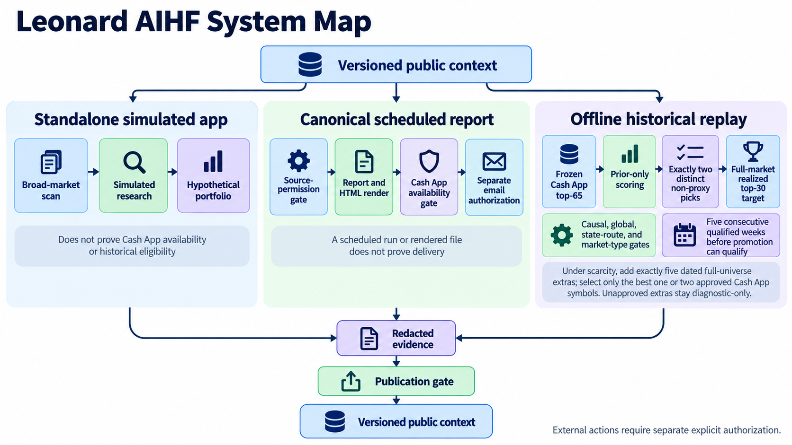

# Leonard AI Hedge Fund Plus System

Public documentation and redacted evidence for AI-assisted investment research. Private runtime, credentials, account data, and live account state stay outside this repository.

The portable context skill is [`atlan-scale`](skills/atlan-scale/SKILL.md). This personal, Atlan-inspired project is not affiliated with linked vendors.

## Start here

```bash
git clone https://github.com/engbyume/ai-hedge-fund-plus-system.git
cd ai-hedge-fund-plus-system
python3 scripts/validate_repo.py
```

| Goal | Read |
| --- | --- |
| Set up and configure a private runtime | [Bootstrap](prompts/00-bootstrap.md), [install and verify](prompts/01-install-and-verify.md), and [configure](prompts/02-configure-your-experiment.md) |
| Run a research cycle without a send or trade | [Daily operator](prompts/03-daily-operator.md) |
| Review results and update rules | [Review and update](prompts/04-review-and-update.md) |
| Import redacted observations or replicate the system | [Evidence import](prompts/05-evidence-import.md), [replication prompt](prompts/replicate-the-system.md), and [setup boundaries](docs/reproduction.md) |

## How it works



The repository documents three separate paths: a simulated app, a source-gated scheduled report, and an offline historical replay. Results from one path do not prove another passed. See the [architecture](ARCHITECTURE.md) and [text system map](docs/system-map.md).

## Documentation

Use the [documentation guide](docs/guide.md) for a reading path through the system, experiments, and evidence.

Use the [documentation guide](docs/guide.md) for a reading path through the system, experiments, and evidence.

| Topic | Pages |
| --- | --- |
| Experiment purpose and success measures | [Purpose and success](docs/purpose-and-success.md) |
| Daily research and decisions | [Daily operations](docs/daily-operations.md) and [decision protocol](docs/decision-protocol.md) |
| Data sources, tools, and forecast models | [Source authority](docs/source-authority.md), [public tools](integrations/tools.md), [Kronos and forecast model history](docs/model-history.md), and [reference patterns](docs/reference-patterns.md) |
| Results, methods, and limitations | [Evaluation and results](docs/evaluation-and-results.md), [experiment history](docs/experiment-history.md), [progress](evidence/progress.md), [decision log](evidence/decision-log.md), [source register](evidence/source-register.md), [weekly checkpoints](evidence/weekly-checkpoints.csv), [success and failure analysis](evidence/success-failure-analysis.md), and [measurement method](docs/evidence-methodology.md) |
| Privacy and licensing | [Privacy and publication rules](docs/privacy-and-publication.md), [third-party notices](THIRD_PARTY_NOTICES.md), and [license](LICENSE) |

## Last recorded evidence

Protected v14 remains at 106 windows, 3 qualified weeks, longest streak 1, and `pass=false`. A matched-window diagnostic on 110 common decision dates found 27 top-30 name hits and 3 two-pick windows for the baseline; causal, global, and state candidates had 15/2, 15/3, and 21/2. Every route's longest streak was 1, so validated prediction accuracy did not improve and no candidate passed the five-week gate. Price stores end September 24, but the latest complete label is September 18 and September 22 row counts remain unreconciled. The latest report is dated September 25 and remains blocked by Cash App availability. The replay uses a dated IWB/IWM holdings proxy; exact Russell 3000 membership and historical Cash App availability remain unverified. No reviewed no-account, no-purchase source meets the required membership and daily-price contract. See [progress](evidence/progress.md) and source entries SRC-223 through SRC-227 for detail.

## Safety and privacy

This is educational research, not financial advice. Forecasts and watchlists do not authorize trades. Every proposed sell needs a paired buy or an approved proceeds hold. Source access, broker actions, email, scheduling, promotion, and publication have separate approval gates.

Keep credentials, account identifiers, raw reports, broker exports, datasets, and private machine paths out of this checkout. Original documentation, prompts, schemas, and scripts use the [MIT license](LICENSE). Linked projects, weights, datasets, and services retain their own terms.
