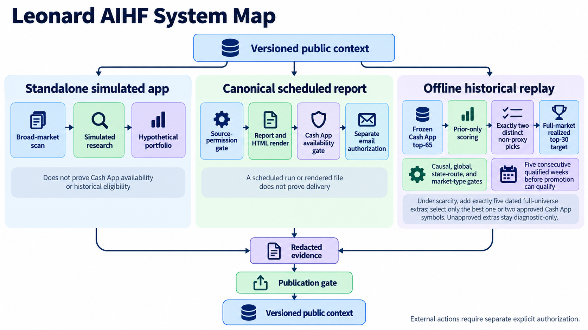

# Leonard system map and operating loop

The system is a context layer around a research and measurement loop.



```text
public methods and versioned context
    +--> standalone simulated app
    |      broad-market screen -> forecast and risk analysis -> hypothetical portfolio
    |      (does not establish Cash App or historical eligibility)
    +--> canonical scheduled report
    |      source-permission gate -> report generation and rendering
    |      -> Cash App availability gate -> separately authorized email
    +--> offline historical replay
           frozen Cash App top-65 -> prior-only scoring and labels
           -> exactly two distinct, non-proxy picks
           -> unchanged full-market realized top-30 target
           -> causal, global, state-route, and market-type gates
           -> five consecutive qualified weeks before promotion can qualify
    -> redacted evidence and changelog, subject to the publication gate
```

These workflows have separate inputs and pass conditions. A simulated scan does not prove platform availability or historical membership. A scheduled report does not prove historical performance. Replay results do not authorize delivery, trading, or promotion by themselves.

When approved-symbol scarcity occurs, the replay may add exactly five dated full-universe candidates. A prior-only score can select only the best one or two approved Cash App symbols. Unapproved extras remain diagnostic-only, and the full-market target stays unchanged.

The loop is intentionally reversible. A forecast can be rejected. A candidate can remain a watchlist item. A proposed sale can be blocked when its paired buy or settlement condition is missing. The context package should explain those decisions instead of treating inaction as missing data.

## Canonical records

| Record | Required fields |
| --- | --- |
| Source | URL, owner, license or terms, retrieved date, role, confidence |
| Preference | benchmark, start date, risk, sectors, weights, schedule, delivery, trade authorization |
| Candidate | ticker, catalyst, catalyst date, evidence, countercase, invalidation, availability, forecasts |
| Action | side, ticker, amount or weight, paired action, settlement state, approval state |
| Observation | timestamp, portfolio return, benchmark return, spread, data freshness, cash-flow treatment |
| Decision | advice, operator choice, rationale, outcome, follow-up, unresolved uncertainty |
